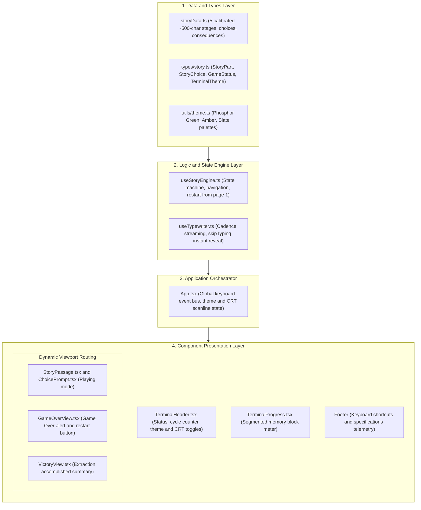
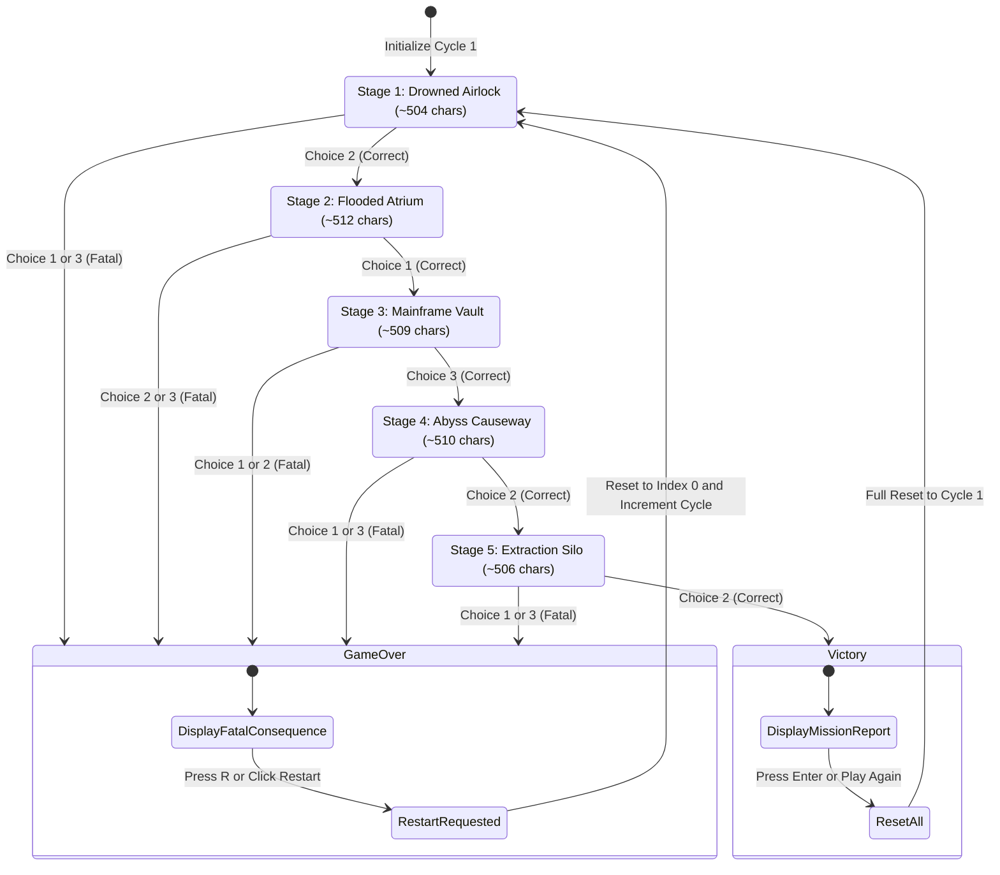
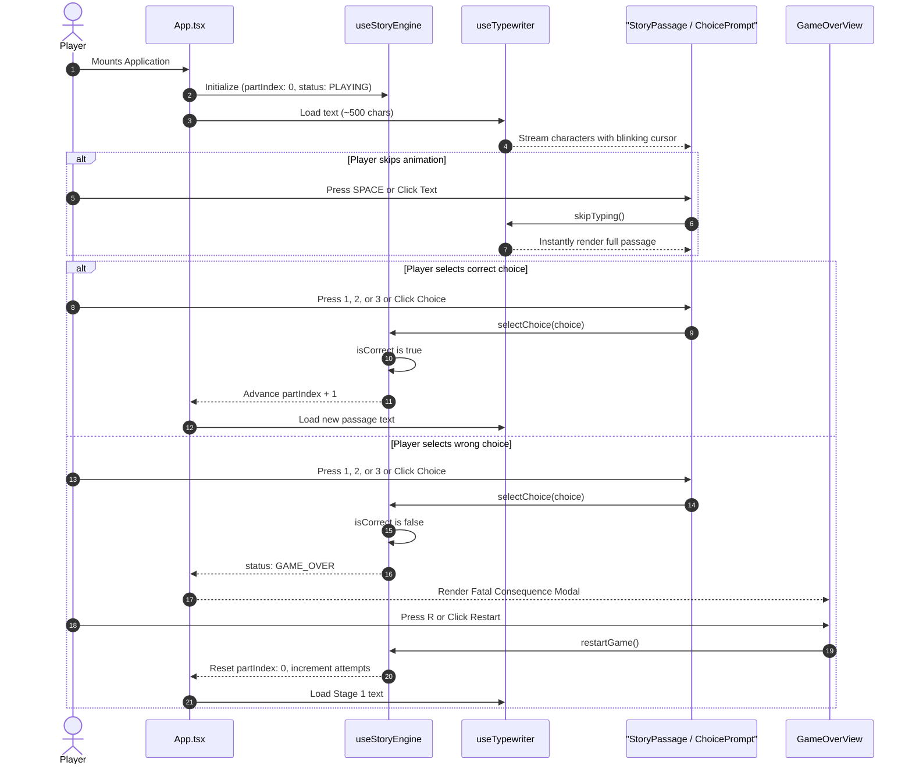

# Interactive Story Terminal: Protocol Omega Deep

A high-immersion, terminal-style interactive fiction reader built with **React**, **TypeScript**, **Tailwind CSS**, and **Vite**.

The story is segmented into calibrated ~500-character narrative stages. At each decision point, players are presented with **3 fixed protocol options**:
- **1 Correct Choice**: Advances the story to the next stage (or achieves planetary escape victory at the final stage).
- **2 Fatal Choices**: Triggers a fatal system outcome and requires the player to **restart from the first page** while tracking cycle attempts.

---

## 🏗️ Architecture Block Schematics

### 1. System Block Diagram



---

### 2. State Transition & Decision Engine



---

### 3. Component Interaction Flowchart



---

## 📂 File Map & Module Roles

```
src/
├── types/
│   └── story.ts              # Data contracts (StoryPart, StoryChoice, GameStatus, TerminalTheme)
├── data/
│   └── storyData.ts          # 5-stage story dataset, each text tuned to ~500 characters
├── hooks/
│   ├── useTypewriter.ts      # Typing animation hook with instant-skip functionality
│   └── useStoryEngine.ts     # Core state machine: choices, game over, restart from page 1
├── components/
│   ├── TerminalHeader.tsx    # Telemetry bar, theme selector (Green/Amber/Slate), CRT toggle
│   ├── TerminalProgress.tsx  # Sector progress bar with active glowing memory blocks
│   ├── StoryPassage.tsx      # Passage reader with character counter & typewriter cursor
│   ├── ChoicePrompt.tsx      # 3 fixed protocol choices with [01], [02], [03] keyboard badges
│   ├── GameOverView.tsx      # System Alert failure screen showing fatal consequence
│   └── VictoryView.tsx       # Mission Accomplished screen with extraction statistics
├── utils/
│   └── theme.ts              # Terminal themes: Phosphor Green, Amber CRT, Cyber Slate
├── test/
│   └── setup.ts              # Vitest + Jest-DOM setup
├── __tests__/
│   ├── storyData.test.ts     # Data integrity tests (~500 chars, 3 choices, 1 valid / 2 fatal)
│   ├── useStoryEngine.test.ts# Logic test suite (navigation, failures, first-page reboot)
│   ├── useTypewriter.test.ts # Fake timer hook tests (streaming, cadence, instant skip)
│   ├── StoryComponents.test.tsx # Component unit tests (Passage, Choice, GameOver, Victory, Header, Progress)
│   └── App.test.tsx          # Full integration suite (E2E story loop, keyboard hotkeys, themes)
├── App.tsx                   # Master keyboard listener and screen router
├── index.css                 # Base styles and CRT scanline overlay rules
└── main.tsx                  # React DOM entry point
```

---

## ⚡ Keyboard Controls

| Key | Context | Action |
| :--- | :--- | :--- |
| `1`, `2`, `3` | Playing | Select protocol choice 1, 2, or 3 |
| `Space` | Playing | Fast-forward / skip typewriter text animation |
| `R` or `Enter` | Game Over | Restart from the first page (Cycle + 1) |
| `R` or `Enter` | Victory | Embark on a new mission (Reset cycles) |

---

## 🧪 Test Suite (30 Passing Tests)

The project includes an automated test suite powered by **Vitest**, **React Testing Library**, and **jest-dom**:

| Test File | Scope | Key Assertions |
| :--- | :--- | :--- |
| [`storyData.test.ts`](src/__tests__/storyData.test.ts) | Data Integrity | Enforces ~500 chars per stage (480–520), exactly 3 choices, 1 valid / 2 fatal, non-empty consequences |
| [`useStoryEngine.test.ts`](src/__tests__/useStoryEngine.test.ts) | State Machine | Progression, game-over trigger, attempts counter, first-page reset, victory condition |
| [`useTypewriter.test.ts`](src/__tests__/useTypewriter.test.ts) | Hook & Timers | Character-by-character cadence via `vi.useFakeTimers()`, instant skip, reset on passage change |
| [`StoryComponents.test.tsx`](src/__tests__/StoryComponents.test.tsx) | Component Units | Telemetry badges, cursor presence, choice payloads, fatal alerts, flawless/survivor badges, theme toggles |
| [`App.test.tsx`](src/__tests__/App.test.tsx) | Full Integration | End-to-end stage navigation, failure reboot cycle, keyboard listeners (`1, 2, 3, Space, R`), CRT scanlines |

Run the test suite:
```bash
npm test
```

---

## 🚀 Development & Testing Commands

```bash
# Install dependencies
npm install

# Run development server
npm run dev

# Run full Vitest test suite (30 test cases)
npm test

# Build for production
npm run build
```
